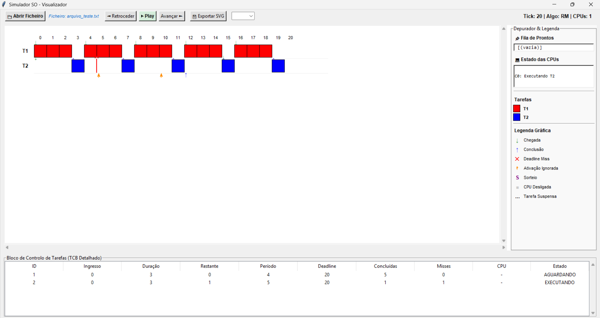
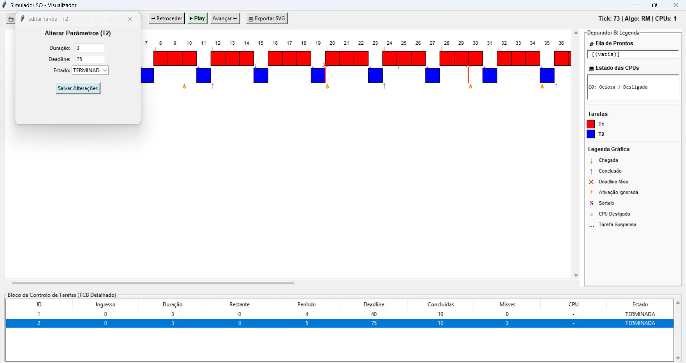
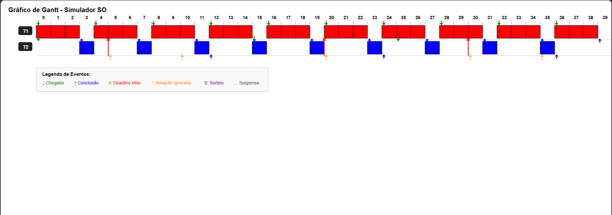
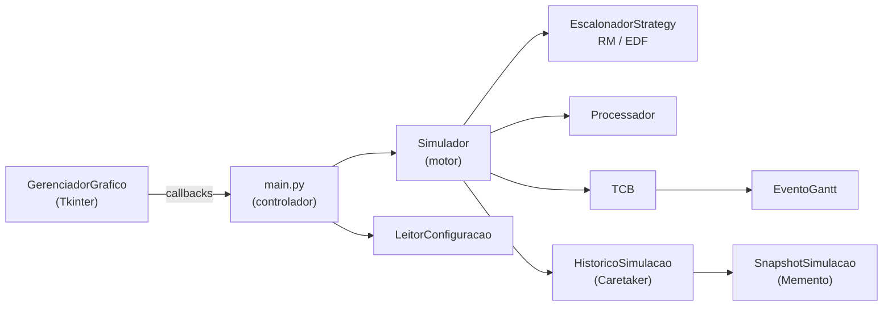

# Simulador de Escalonamento de Tarefas de Tempo Real

Simulador interativo de escalonamento de tarefas periódicas em sistemas operacionais de tempo real, com suporte a **RM (Rate Monotonic)** e **EDF (Earliest Deadline First)**, múltiplas CPUs, gráfico de Gantt em tempo real e **navegação temporal** (avançar, retroceder e editar o passado).

> Projeto A da disciplina de Sistemas Operacionais.


---

## Sumário

- [Funcionalidades](#funcionalidades)
- [Capturas de tela](#capturas-de-tela)
- [Pré-requisitos](#pré-requisitos)
- [Como executar](#como-executar)
- [Formato do arquivo de entrada](#formato-do-arquivo-de-entrada)
- [Como usar a interface](#como-usar-a-interface)
- [Algoritmos e critérios de desempate](#algoritmos-e-critérios-de-desempate)
- [Arquitetura](#arquitetura)
- [Estrutura do projeto](#estrutura-do-projeto)
- [Ciclo de vida de uma tarefa](#ciclo-de-vida-de-uma-tarefa)
- [Limitações conhecidas](#limitações-conhecidas)
- [Autores](#autores)
- [Licença](#licença)

---

## Funcionalidades

- **Escalonamento preemptivo** com os algoritmos **RM** (prioridade fixa) e **EDF** (prioridade dinâmica).
- **Multiprocessamento**: número configurável de CPUs, com registro do tempo em que cada CPU ficou desligada (ociosa).
- **Desempate em cinco níveis**, com **sorteio** registrado visualmente quando o empate persiste.
- **Gráfico de Gantt** em tempo real, com marcadores de chegada, término de execução e perda de deadline.
- **Viagem no tempo**: avançar, retroceder e reproduzir (Play) sem recalcular o que já foi simulado.
- **Edição retroativa**: altere duração, prazo ou estado de uma tarefa e a simulação continua a partir dali (ramificação da linha do tempo).
- **Troca dinâmica de algoritmo** (RM ⇄ EDF) durante a simulação.
- **Exportação do Gantt em SVG**, inclusive de forma automática ao fim da simulação.
- **Validação do arquivo de entrada** com mensagens de erro e aviso claras.
- **Painel de depuração** com a fila de prontos e o estado de cada CPU em tempo real (executando ou ociosa/desligada).
- **Bloco de Controle de Tarefas (TCB)** detalhado: tempo restante, instâncias concluídas, número de misses, CPU alocada e estado.

---

## Capturas de tela

### Execução passo a passo

Acompanhe a simulação tick a tick: o Gantt é construído a cada avanço, com marcadores de eventos. O painel lateral exibe a fila de prontos e o estado de cada CPU, e a tabela inferior mostra os dados de cada tarefa em tempo real.



### Alteração de tarefas durante a execução

Com um duplo clique na tabela de tarefas, é possível editar duração, deadline e estado de uma tarefa. A simulação continua a partir do ponto alterado.



### Gráfico de Gantt exportado

Ao final, o gráfico completo pode ser exportado em SVG, com a legenda de eventos incluída.



---

## Pré-requisitos

- **Python 3.8** ou superior
- **Tkinter** (já incluído na instalação padrão do Python no Windows e macOS)

Nenhuma dependência externa é necessária.

Em distribuições Linux baseadas em Debian/Ubuntu, instale o Tkinter caso ainda não esteja disponível:

```bash
sudo apt install python3-tk
```

---

## Como executar

```bash
# 1. Clone o repositório
git clone https://github.com/Felipe-Silvy/Simulador_Visual-Sistema_Operacional.git
cd Simulador_Visual-Sistema_Operacional

# 2. Execute
python main.py
```

Em seguida, clique em **Abrir Ficheiro** e selecione um arquivo `.txt` de configuração.

---

## Formato do arquivo de entrada

O arquivo é um `.txt` em que campos são separados por `;`. Linhas em branco são ignoradas.

**Linha 1: cabeçalho do sistema**

```
algoritmo;quantum;qtde_cpus
```

**Demais linhas: uma tarefa por linha**

```
id;cor;ingresso;duracao;periodo;prazo[;lista_eventos]
```

| Campo           | Descrição                     | Regra                                  |
| --------------- | ----------------------------- | -------------------------------------- |
| `algoritmo`     | Política de escalonamento     | `RM` ou `EDF`                          |
| `quantum`       | Quantum de tempo              | inteiro ≥ 1                            |
| `qtde_cpus`     | Número de processadores       | inteiro ≥ 1                            |
| `id`            | Identificador da tarefa       | inteiro, único                         |
| `cor`           | Cor da tarefa no Gantt        | 6 dígitos hexadecimais (ex.: `FF0000`) |
| `ingresso`      | Instante da primeira ativação | inteiro ≥ 0                            |
| `duracao`       | Tempo de CPU por instância    | inteiro ≥ 1                            |
| `periodo`       | Intervalo entre ativações     | inteiro ≥ 1                            |
| `prazo`         | Deadline relativo à ativação  | inteiro ≥ 1                            |
| `lista_eventos` | Reservado (opcional)          | ignorado no Projeto A                  |

### Exemplo

```
EDF;1;2
1;FF0000;0;2;5;5
2;00AA00;0;3;7;7
3;0000FF;1;1;4;4
```

Duas CPUs, algoritmo EDF e três tarefas periódicas.

### Validações

| Situação                          | Resultado                                                     |
| --------------------------------- | ------------------------------------------------------------- |
| Arquivo com menos de 2 linhas     | Erro                                                          |
| Algoritmo desconhecido            | Erro                                                          |
| Quantum ou CPUs inválidos         | Erro                                                          |
| Campos faltando ou não numéricos  | Erro                                                          |
| Cor fora do padrão hexadecimal    | Erro                                                          |
| ID repetido                       | Erro                                                          |
| Período negativo                  | Erro                                                          |
| `periodo = 0` (tarefa aperiódica) | Aviso: tarefa ignorada (o Projeto A aceita apenas periódicas) |

---

## Como usar a interface

| Controle                              | Função                                                            |
| ------------------------------------- | ----------------------------------------------------------------- |
| **Abrir Ficheiro**                    | Carrega e valida o arquivo de configuração e reinicia a simulação |
| **Avançar**                           | Executa um tick (ou refaz um tick já calculado)                   |
| **Retroceder**                        | Volta ao tick anterior                                            |
| **Play / Pausa**                      | Avança automaticamente até o fim ou até pausar                    |
| **Exportar SVG**                      | Salva o Gantt atual como imagem vetorial                          |
| **Duplo clique na tabela de tarefas** | Edita duração, prazo e estado da tarefa                           |
| **Seletor de algoritmo**              | Troca entre RM e EDF durante a simulação                          |

### Legenda do Gantt

| Símbolo        | Significado                                                                 |
| -------------- | --------------------------------------------------------------------------- |
| Bloco colorido | Tarefa executando (com `C0`, `C1`... indicando a CPU em sistemas multi-CPU) |
| `↓` verde      | Chegada (ativação) de uma instância                                         |
| `↑` azul       | Fim da execução de uma instância                                            |
| `✕` vermelho   | Perda de deadline                                                           |
| `↑` laranja    | Ativação ignorada (instância anterior ainda pendente)                       |
| `S` roxo       | Sorteio no desempate                                                        |
| `...`          | Tarefa suspensa                                                             |

---

## Algoritmos e critérios de desempate

A cada tick, o escalonador ordena as tarefas candidatas (prontas + em execução) e seleciona as `N` mais prioritárias, sendo `N` o número de CPUs.

### Critério principal

| Algoritmo | Chave de prioridade       | Tipo                |
| --------- | ------------------------- | ------------------- |
| **RM**    | Menor `periodo`           | Prioridade fixa     |
| **EDF**   | Menor `deadline_absoluto` | Prioridade dinâmica |

### Desempates (nesta ordem)

1. Tarefa que **já está executando** (evita trocas de contexto desnecessárias)
2. Menor `prazo`
3. Menor `ingresso`
4. Menor `duracao`
5. **Sorteio** aleatório, registrado como evento `SORTEIO` quando o corte do escalonamento cai no meio de um empate

---

## Arquitetura

O projeto adota os padrões **Strategy** (escalonadores intercambiáveis) e **Memento** (snapshots para desfazer/refazer), com a interface desacoplada da lógica via **callbacks**.



### Ciclo de um tick

Cada chamada a `tick()` executa, em ordem:

1. **`_ativar_tarefas`**: ativa instâncias cujo período chegou (`(relogio - ingresso) % periodo == 0`) e registra `CHEGADA`. Se a instância anterior ainda está pendente, registra `ATIVACAO_IGNORADA`.
2. **`_verificar_deadlines`**: registra `DEADLINE_MISS` para tarefas pendentes que atingiram o deadline.
3. **`_escolher`**: pede ao escalonador as tarefas que devem ocupar as CPUs.
4. **`_aplicar_decisao`**: faz a preempção das tarefas que perderam prioridade, aloca as novas e desliga CPUs sem trabalho.
5. **`_executar_tick`**: consome 1 unidade de tempo de cada tarefa em execução e registra `EXECUCAO`/`FIM`.
6. **Relógio + 1** e **snapshot** do novo estado.

### Navegação temporal

- Cada tick gera um `SnapshotSimulacao` (cópia profunda de CPUs, tarefas e fila de prontos).
- `HistoricoSimulacao` mantém a lista de snapshots e um índice atual.
- **Retroceder** move o índice para trás e restaura o snapshot.
- **Avançar** após retroceder apenas **refaz** os snapshots já calculados, sem recomputar (o resultado visto é idêntico, inclusive sorteios).
- **Editar tarefa** ou **trocar algoritmo** descarta o futuro e continua a simulação a partir do estado alterado.

---

## Estrutura do projeto

```
.
├── main.py                 # Ponto de entrada e controlador (liga GUI ↔ simulador)
├── GerenciadorGrafico.py   # Interface Tkinter, Gantt e exportação SVG
├── simulador.py            # Motor da simulação (relógio, ticks, preempção)
├── escalonador.py          # Strategy: RM, EDF e critérios de desempate
├── leitor.py               # Leitura e validação do arquivo de configuração
├── tcb.py                  # Task Control Block (dados e estado da tarefa)
├── processador.py          # Modelo de CPU
├── gantt.py                # EventoGantt (chegada, execução, fim, miss...)
├── snapshot.py             # Memento: cópia do estado em um instante
└── historico.py            # Caretaker: linha do tempo de snapshots
```

---

## Ciclo de vida de uma tarefa

```
AGUARDANDO ──(ativação periódica)──► PRONTA ──(escolhida)──► EXECUTANDO
     ▲                                  ▲                        │
     │                                  └──(preempção)───────────┤
     └──(instância concluída, < 10)───────────────────────────────┤
                                  TERMINADA ◄──(10 instâncias)────┘
```

Cada tarefa é simulada por **10 instâncias**; ao concluir a décima, passa a `TERMINADA`. A simulação termina quando todas as tarefas estão `TERMINADA`.

---

## Limitações conhecidas

- O campo `quantum` é lido e validado, mas **não é utilizado**: RM e EDF são preemptivos por tick.
- Tarefas aperiódicas (`periodo = 0`) são ignoradas; o campo `lista_eventos` está reservado para o Projeto B.
- Editar o `prazo` de uma tarefa afeta apenas as próximas ativações, pois o EDF e a detecção de perda de deadline usam o `deadline_absoluto` da instância corrente.
- O algoritmo ativo não é guardado nos snapshots: ao trocar de algoritmo e retroceder, o rótulo exibido pode divergir do algoritmo que gerou os ticks antigos.
- `Simulador.executar()` não possui limite de ticks.

---

## Autores

- **Felipe Domingos Silvy**: [@Felipe-Silvy](https://github.com/Felipe-Silvy)
- **Pedro Kazuo Asami Goto**: [@pkagoto](https://github.com/pkagoto)

Disciplina de Sistemas Operacionais, Universidade Tecnológica Federal do Paraná (UTFPR), 4º semestre de Sistemas de Informação (2026.2).

---

## Licença

Distribuído sob a licença MIT. Veja o arquivo [LICENSE](LICENSE) para mais detalhes.
